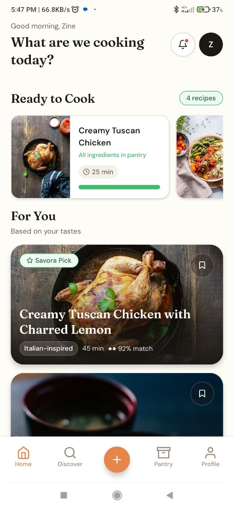

# Savora

**Cook smarter. Waste less. Eat better.**

Savora is a mobile-first cooking app built on a simple premise: cooking apps should be useful *in* the kitchen, not just pleasant to browse on a laptop. The core experience lives on the phone — import a recipe, match it against what's in your pantry, and cook hands-free while the screen stays awake and your hands stay busy.

<p align="center">
  
</p>

<p align="center">
  
  
  
</p>

---

## Table of Contents

- [Why Savora](#why-savora)
- [Core Features](#core-features)
- [Platform Strategy](#platform-strategy)
- [Tech Stack](#tech-stack)
- [Repository Layout](#repository-layout)
- [Getting Started](#getting-started)
- [Build Roadmap](#build-roadmap)
- [Documentation](#documentation)
- [Status](#status)
- [License](#license)

---

## Why Savora

Most "recipe apps" are recipe *websites* wrapped in a mobile shell. Savora is designed the other way around: the differentiated value only exists because it's mobile-native.

- The strongest features depend on device hardware and OS-level integrations (camera, voice, screen wake-lock).
- A single React Native codebase covers iOS and Android, so the product logic isn't duplicated per platform.
- The backend (Django + DRF + Channels) stays identical regardless of which client is talking to it.
- Shipping Android-first shortens the iteration loop and avoids App Store review friction during early demos.

Building a web app first would mean shipping the least differentiated version of the product. So the mobile app *is* the product — the web experience is a companion surface that comes later.

## Core Features

| Feature | Description |
|---|---|
| **Fast recipe capture** | Import recipes from URLs, photos, dictation, or manual entry |
| **Camera OCR** | Digitize recipes straight from cookbook pages or receipts |
| **Pantry tracking** | Structured inventory of what you actually have on hand |
| **Smart matching** | Recipes matched against pantry contents automatically |
| **Cooking Mode** | Wake-lock, step-by-step guidance so the screen never sleeps mid-recipe |
| **Hands-free control** | Voice and gesture support for moving through steps without touching the phone |

## Platform Strategy

**Phase 1 — Core product**
- `apps/mobile` — primary product surface
- `backend` — shared API and realtime infrastructure

**Phase 2 — Companion surfaces**
- `apps/web` — landing page, account management, recipe-importer extension support

## Tech Stack

**Mobile**
- React Native + Expo (TypeScript)
- React Navigation — app shell and tab navigation
- Zustand — app-level client state
- TanStack Query — API sync and server cache
- Expo SQLite — offline-first local storage
- Expo Keep Awake — screen wake-lock during Cooking Mode
- Reanimated — motion and transitions

**Backend**
- Django + Django REST Framework
- Django Channels — realtime features
- Local-first sync model with background reconciliation

**Web Companion** *(Phase 2)*
- Marketing site, account settings, and import-helper tooling

## Repository Layout

```
savora_cook_smarter/
├── apps/
│   ├── mobile/          # React Native / Expo app — primary product surface
│   └── web/             # Companion web surfaces (Phase 2)
├── backend/             # Django + DRF + Channels API
└── README.md
```

## Getting Started

> The project is in active early development — setup steps will be filled in as `apps/mobile` and `backend` reach a runnable state.

```bash
# Clone the repo
git clone https://github.com/Zineddine-Rebbouh/savora_cook_smarter.git
cd savora_cook_smarter

# Mobile app
cd apps/mobile
npm install
npx expo start

# Backend
cd ../../backend
python -m venv venv && source venv/bin/activate
pip install -r requirements.txt
python manage.py runserver
```

## Build Roadmap

The mobile app is being built as a sequence of production-quality vertical slices, not throwaway prototypes:

1. Recipe Detail Screen
2. Home / Discovery Feed
3. Import URL Flow
4. Pantry Screen
5. Cooking Mode
6. Smart Substitution Bottom Sheet
7. Discover / Search
8. Meal Planner
9. Profile + Cook Log
10. Onboarding

## Documentation

Deeper design and planning docs live alongside the code as the project matures:

- Savora Design Brief
- Mobile-First Architecture
- Build Sequence Roadmap

## Status

🚧 **Early development.** Product direction, design system, and architecture are defined; `apps/mobile` is being built out screen by screen starting with Recipe Detail.

## License

No license has been set for this repository yet — all rights reserved by default until one is added.
